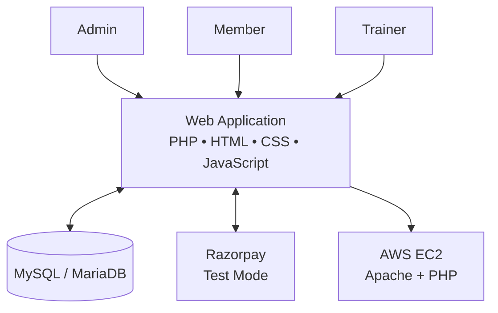

website: https://3.25.154.187/gym-management/

# VORTEX FITNESS --- Gym Management System

**A web-based platform for managing gym members, memberships,
attendance, trainers, and payments.**

:::📌 About the Project
VORTEX FITNESS is a PHP-based Gym Management System designed to
centralize everyday gym operations in one web application. It uses
MySQL/MariaDB for application data and includes role-oriented pages for
gym administrators, trainers, and members.
The project has been deployed to an AWS EC2 development environment.
Payment integration has been exercised in Razorpay test mode.
Features and production readiness should be verified against the current
code before real-world use.
✨ Key Features
  Module                              Purpose
  📊 Dashboard                        Quick access to operational
                                      summaries and management pages
  👥 Member Management                Maintain member records
  🗓️ Membership Plans                 Manage available membership plans
                                      and memberships
  ✅ Attendance                       Record and review attendance
  🏋️ Trainer Management               Maintain trainer details and
                                      related workflows
  💳 Payments                         Review payment records and
                                      payment-related workflows
  🔐 Role-oriented pages              Admin, member, and trainer
                                      interfaces
  🍪 Cookie Preferences               Cookie banner and optional
                                      analytics preference controls
  🛡️ Privacy Pages                    Privacy policy, cookie policy, and
                                      terms pages
  🗑️ Data Deletion Requests           Submit and manage data deletion
                                      requests
  ☁️ AWS EC2                          Cloud deployment environment
Implementation note: This list describes modules present or
planned in the project context. Verify each workflow, especially
consent logging, authorization, deletion, and payment verification,
before treating it as production-ready.

🏗️ System Architecture

The browser communicates with the PHP application. The application reads
and writes data in MySQL/MariaDB and can interact with Razorpay for
test-mode payment flows. AWS EC2 is the described deployment
environment.
🧰 Technology Stack
- Backend: PHP
- Database: MySQL / MariaDB
- Frontend: HTML, CSS, JavaScript
- Database access: PDO where configured
- Payments: Razorpay test mode
- Cloud deployment: AWS EC2
- Web server: Apache on the described EC2 setup
📂 Project Structure
The following is a representative structure. The exact folders can vary
by branch and implementation.
vortex-fitness-gym-management/
├── admin/                  # Admin pages and workflows
├── member/                 # Member-facing pages
├── trainer/                # Trainer management pages
├── trainer_portal/         # Trainer portal
├── attendance/             # Attendance workflows
├── members/                # Member records
├── membership/             # Membership workflows
├── plans/                  # Membership plans
├── payments/               # Payment workflows
├── users/                  # User administration
├── includes/               # Shared components
├── config/                 # Local configuration (secrets excluded)
├── css/                    # Stylesheets
├── js/                     # JavaScript files
├── docs/
│   └── images/
│       └── vortex-fitness-banner.png
├── .gitignore
└── README.md
🚀 Local Setup
Requirements
- PHP and the PDO MySQL extension
- MySQL or MariaDB
- Apache or another PHP-capable web server
- Git (to clone the repository)
- A modern web browser
XAMPP is one option for local development because it bundles Apache,
PHP, and MySQL/MariaDB components.
1. Clone the repository
git clone https://github.com/jaswanthkumar1901-source/vortex-fitness-gym-managemen.git
cd vortex-fitness-gym-managemen
2. Create a database
Create a local MySQL/MariaDB database. The EC2 environment has used the
database name vortex_fitness; set your local database name to match
your local configuration.
3. Configure credentials
Configure the database host, port, database name, username, and password
in a protected local configuration file or environment variables.
Never commit production credentials. If the application expects
config/database.php, keep the real file local/on the server and commit
only a sanitized example such as config/database.example.php.
4. Import the schema
Import the project's schema or migration files if included. If the
repository does not contain a schema export, prepare a clean
schema/migration for fresh installations rather than using a production
database dump containing personal data.
5. Start the application
Place the project under your local web server's document root, then
visit the configured URL. For a typical XAMPP folder named
gym-management, this may be:
http://localhost/gym-management/
The URL can differ depending on the local folder and server
configuration.
💳 Razorpay Integration
The project has used Razorpay in test mode. Before enabling live
payments:
1. Store API keys securely on the server.
2. Verify payment signatures server-side.
3. Validate order amount and membership details server-side.
4. Handle success, failure, pending, and duplicate events.
5. Verify webhook signatures if webhooks are enabled.
6. Test the complete payment-to-membership activation flow.
7. Never expose secret keys in browser JavaScript or Git commits.
☁️ AWS EC2 Deployment
The project has been deployed in an EC2 environment. A production
deployment should include:
- A supported EC2 operating system and patched packages
- Apache, PHP, and required PHP extensions
- A database service with restricted network access
- Protected configuration and least-privilege database credentials
- Security group rules limited to required ports
- HTTPS and tested certificate renewal
- Secure file permissions, logs, backups, and monitoring
Avoid exposing the database port publicly unless there is a specific,
secured requirement.
🔒 Security & Privacy Checklist
Before using the system with real members, verify:
- [ ] Passwords use secure password hashing.
- [ ] Authentication and role authorization are enforced server-side.
- [ ] SQL operations use prepared statements where appropriate.
- [ ] State-changing forms have CSRF protection.
- [ ] Sessions and cookies use secure settings over HTTPS.
- [ ] Payment signatures and order amounts are verified server-side.
- [ ] Optional analytics do not run before the required consent is
  granted.
- [ ] Cookie choices are saved and server-side consent records are
  verified.
- [ ] Data deletion and unsubscribe workflows are tested.
- [ ] Debug scripts, credentials, and test data are removed from
  production.
- [ ] Backups do not expose member information.
- [ ] Accessibility, performance, and security checks have been
  reviewed.
A privacy policy or consent banner alone does not establish legal
compliance. Review the rules applicable to the intended deployment.
🧪 Testing Checklist
- [ ] Database connection succeeds with a least-privilege account.
- [ ] Admin, member, and trainer access behaves as intended.
- [ ] Member, membership, plan, and attendance workflows work.
- [ ] Payment success, failure, retry, and duplicate scenarios are
  tested.
- [ ] Cookie banner actions persist correctly across visits.
- [ ] Consent records appear in the database after explicit choices.
- [ ] Optional analytics remain disabled without consent.
- [ ] Data deletion request handling is verified.
- [ ] Mobile layout, keyboard navigation, and accessible labels are
  checked.
- [ ] HTTPS, logs, permissions, and backups are verified.
🤝 Contributing
Suggestions and contributions are welcome.
1. Fork the repository.
2. Create a focused feature branch.
3. Make and test your changes locally.
4. Open a pull request with a clear summary and test notes.
Do not include secrets, real member data, private database dumps, or
private keys in commits.
📄 License
No license has been specified yet. Unless a license is added to the
repository, reuse and redistribution permissions are not explicitly
granted. Add an appropriate LICENSE file before inviting external
reuse.
::: {align="center"}
**VORTEX FITNESS --- Stronger operations. Better gym management.**

If this project is useful to you, consider giving the repository a ⭐ on
GitHub.
:::
